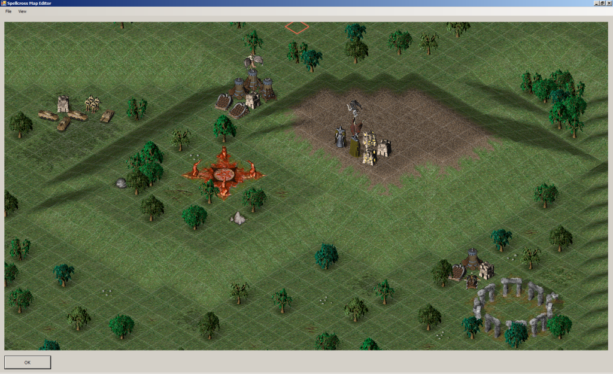

# Spellcross Map Editor — Reloaded integration fork

**A standalone map and resource editor for [Spellcross (1997)](https://en.wikipedia.org/wiki/Spellcross), maintained here as the editor component of [Spellcross Reloaded](https://github.com/luboshorak/spellcross-reloaded).**

This repository is a **fork of [Stanislav Mašláň's original Spellcross Map Editor](https://github.com/smaslan/spellcross-map-edit)**, not a replacement for it and not the playable Spellcross Reloaded game. Mašláň created the editor, reverse-engineered the original file formats and wrote the underlying map/resource editing tools. This fork keeps that work available while adding the data-loading and build compatibility changes needed to ship it alongside Reloaded.

| Looking for… | Go to |
| --- | --- |
| **Playable game + integrated editor for Windows x64** | [Spellcross Reloaded v0.8.1 download](https://github.com/luboshorak/spellcross-reloaded/releases/tag/v0.8.1) |
| Playable restoration source and combined build scripts | [Spellcross Reloaded repository](https://github.com/luboshorak/spellcross-reloaded) |
| Mašláň's original, independently maintained map editor | [Original editor (upstream)](https://github.com/smaslan/spellcross-map-edit) |
| Full editor usage/reference documentation | [Detailed original editor guide](./doc/UPSTREAM_EDITOR_GUIDE.md) |

## What this editor does

The original editor remains the foundation. Among its existing tools are:

- Open, render and edit tactical **DTA maps** and **DEF mission scripts**.
- Work with terrain tiles, objects, multiple map layers, animations and tile flags.
- Edit unit placement, map events, objectives, mission parameters and object templates.
- Inspect, export and encode Spellcross graphics and text resources.
- Browse sprites, palettes, sounds, MIDI music and supported video resources.
- Work with Spellcross mods, including the [Spellcross Mod Launcher](https://github.com/smaslan/Spellcross-Mod-Launcher).

**Important:** this is still an experimental editor. Autotiling, complex mission editing and some resource workflows are not fully automated or polished. The original editor's experimental **Game** mode is not the playable Reloaded campaign; for that, run Spellcross Reloaded itself.

More screenshots and explanations are in the [editor guide](./doc/UPSTREAM_EDITOR_GUIDE.md).

## What is different in this fork?

**Reloaded integration (2026):**

- **Portable first-run data discovery:** find existing original Spellcross archives, including a shared `game_data/DATA` folder from Reloaded.
- **Shared game-data configuration:** read archive locations from Reloaded's `config.ini`, including individual `[FILES]` entries, rather than relying solely on the old editor's installation paths.
- **Original CD / mounted ISO import:** extract installed archives from `DATA/INSTALL.DTA` when no usable game-data installation is available.
- **Correct precedence for modded archives:** a configured mod's `MAKE` files are checked before configured Reloaded archive overrides and regular game-data paths.
- **Editor-specific auxiliary data:** resolve the editor's own fonts, terrain contexts, `units.fsa` and `COMMON.fs` independently of the original retail game's `COMMON.FS`.
- **Executable-local configuration:** store the editor's settings in `config.ini` beside its executable; the game has a different `config.ini`.
- **MSVC/C++20 build compatibility fixes** for the current integrated Windows x64 build.

The fork deliberately keeps these changes separate from the editor's core editing features, making it easier to continue incorporating improvements from Mašláň's upstream project.

### Drag placed map objects (development preview)

With **no painting brush selected**, hold the left mouse button on an existing **L2 object**, drag it to a free map location, and release. The source object is removed only if the destination is valid, and the move is added to Undo history. The preview is displayed while dragging. Where an exact original multi-cell L2 prefab can be recognized, its pieces move together.

The move deliberately **does not alter L1 ground tiles**. Buildings with baked-in L1 graphics cannot yet be moved safely because the map does not preserve the original landscape underneath them. Dragging a mission marker or dropping onto an occupied L2 cell is rejected with a status message. Clear an active tile brush before dragging existing objects.

### Tile painting and rotation (development preview, unreleased)

Select a brush in the terrain ribbon and left-click the map to paint. The map status bar reports selected and placed sprites; the editor supports Undo/Redo.

**Flat L1 terrain tiles and complete multi-cell flat brushes** (including roads, paths and flat road prefabs) can now be turned in the *isometric ground plane* without pre-made original directions:

- **R** – 90° clockwise.
- **Shift+R** – 90° counter-clockwise.
- Four presses restore the original orientation and the relative arrangement of tiles. The full brush preview at the cursor updates before placement.
- Multi-cell rotation transforms each flat sprite **and** its relative position on the staggered map grid; complex L2/animated/raised objects are rejected safely.
- **Ctrl+mouse wheel** continues to cycle through original predefined sprites and tool variants (and resets a custom rotation).

The palette-indexed, rotated tile is generated on demand, not baked into the original commercial `.FS` files. Map files save a deterministic eight-character virtual sprite name (`R0Axxxxx`) identifying the original terrain sprite and quarter turn. **Both the Reloaded game and this fork of the editor must contain the new virtual-rotation decoder** to reopen those modified maps. Original retail Spellcross, the upstream editor v0.90 and older Reloaded builds cannot resolve virtual sprite names. Back up maps and distribute changes only with a matching new game build.

Rotation is intentionally limited to the flat `A` terrain shape with normal ground elevation (0 pixel sprite offset). Multi-cell brushes work only when **all** constituent tiles are flat L1 sprites, with no L2 parts or animations. Sloped `B`–`M` terrain, 3D houses, raised objects and animations remain excluded. Nearest-neighbour resampling may produce minor pixel jaggies on angled road edges.

## Download and first use (recommended)

The simplest way to run this editor is to download **[Spellcross_Reloaded_v0.8.1.zip](https://github.com/luboshorak/spellcross-reloaded/releases/tag/v0.8.1)**, which contains both programs:

~~~text
Spellcross.exe                     playable game
data/                              Reloaded support assets
Editor/
  spellcross_map_editor.exe       standalone map editor
  data/                            editor-specific support assets
game_data/DATA/                   created when original data are imported
~~~

1. Extract the complete ZIP to a **writable directory** on Windows 10/11 x64.
2. Run **Spellcross.exe** first. Select your existing original Spellcross archive files or import them from an **original CD / mounted ISO**.
3. Then run **Editor/spellcross_map_editor.exe**. It will look for those same archives automatically.
4. To edit a mission, extract the appropriate files from the original retail **COMMON.FS** using the editor's **Tools → Extract FS archive** function or an external extraction tool. Open the extracted **DTA** map or **DEF** mission script.
5. Save modified maps under a **new filename** and keep backups. Different DEF scripts can reference the same DTA map.

The original retail archives are **not** supplied with the project. You must provide them from your own Spellcross copy. The importer works with a *mounted* ISO/CD directory, not a raw `.iso` filename. A Windows x64 [Visual C++ Redistributable](https://aka.ms/vc14/vc_redist.x64.exe) may be required.

### Running the editor on its own

The editor can also be built and launched outside the combined game package. Keep the repository's **data/** folder available: it contains *editor-generated support assets*, which are different from the original game's files. At startup the editor searches nearby directories for its support data and the original game archives. If it cannot find a valid installation, it prompts you to select an existing game-data folder or import from CD.

The editor writes its own `config.ini` beside the executable. Do not copy the upstream `source/config.ini` template verbatim: it contains machine-specific example paths from the original author.

## Building from source

The project currently targets **C++20 / MSVC / wxWidgets** and includes a Visual Studio solution at **source/spellcross_map_editor.sln**. The integrated Windows build uses the **v145** platform toolset and **Release | x64**; a different installed toolset may require retargeting the Visual Studio project. The `wxwin` property must point to a correctly configured wxWidgets installation with its include and library paths.

For the **supported combined game + editor build**, use the parent project's build script instead of manually collecting DLLs:

~~~powershell
git clone --recurse-submodules https://github.com/luboshorak/spellcross-reloaded.git
cd spellcross-reloaded
.\packaging\Build-CombinedRelease.ps1 -WxRoot "$HOME\vcpkg\installed\x64-windows"
~~~

See [combined release build instructions](https://github.com/luboshorak/spellcross-reloaded/blob/main/packaging/README.md) for the required Windows tools and MP4 video inputs. If working directly on this editor fork, use **source/spellcross_map_editor.sln** and make sure the auxiliary **data/** files are accessible when running the built executable.

The game includes this editor as a **Git submodule** at `external/map-editor`. Editing this fork does **not** automatically update the version pinned by the game: the game repository must explicitly update the submodule reference.

## Origins, credits and license

- **Original editor and reverse-engineering foundation:** [Stanislav Mašláň / smaslan/spellcross-map-edit](https://github.com/smaslan/spellcross-map-edit).
- **Reloaded integration and build changes:** [Spellcross Reloaded contributors](https://github.com/luboshorak/spellcross-reloaded).
- **Historical upstream documentation:** [complete editor guide](./doc/UPSTREAM_EDITOR_GUIDE.md).
- **Supporting libraries:** [wxWidgets](https://www.wxwidgets.org/), [SimpleIni](https://github.com/brofield/simpleini), [RtAudio](https://github.com/thestk/rtaudio), [cxxmidi](https://github.com/5tan/cxxmidi), and [Spellcross Mod Launcher](https://github.com/smaslan/Spellcross-Mod-Launcher).

The editor code is distributed under the **[MIT License](./LICENSE)**, with Mašláň's original copyright retained. The license does **not** grant rights to original commercial Spellcross game assets. This is an independent fan project, not an official game release.
