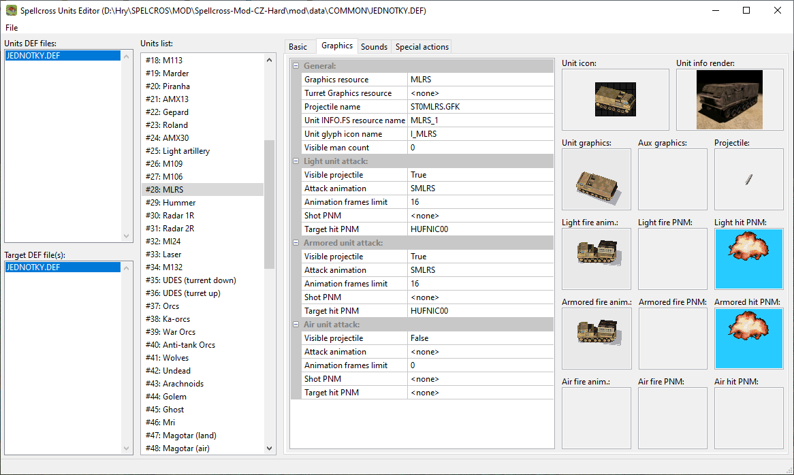

# Spellcross Map Editor — Reloaded fork

**Edit the maps and missions of the original Spellcross, with a few modern conveniences.**

This is the standalone editor included with [Spellcross Reloaded](https://github.com/luboshorak/spellcross-reloaded). It lets you open the original tactical maps, inspect their layers, place terrain and objects, work with units and events, and save modified missions.

It builds on [Stanislav Mašláň's original Spellcross Map Editor](https://github.com/smaslan/spellcross-map-edit). His work on the game formats, editor and resource tools remains the foundation of this fork.

**[Download the latest Spellcross Reloaded release (game + editor)](https://github.com/luboshorak/spellcross-reloaded/releases/latest)** · **[Standalone editor releases](https://github.com/luboshorak/spellcross-reloaded-editor/releases)** · [Original editor](https://github.com/smaslan/spellcross-map-edit) · [Full editor reference](./doc/UPSTREAM_EDITOR_GUIDE.md)

## Start editing

The easiest way to get the editor is through the combined Spellcross Reloaded download:

1. Download the [latest Spellcross Reloaded release](https://github.com/luboshorak/spellcross-reloaded/releases/latest). Install the `.exe` package or extract the `.zip` package into a writable folder.
2. Run `Spellcross.exe` once and point it to your original Spellcross data. Reloaded can import directly from a raw ISO, from a CD/mounted folder, or from an existing `DATA` directory.
3. Run `Editor/spellcross_map_editor.exe`. It can reuse the archives already configured for the game.
4. Open a tactical `.DEF` mission or `.DTA` map. Missions and the maps they reference must remain accessible together.
5. Save edited content under a **new filename** until you're happy with it.

You can also launch the editor from Reloaded's main menu, or open the *original mission* from an active tactical battle using the game's save/open/cancel prompt. It does **not** import your live battle state into the editor.

The editor and game keep separate `config.ini` files. You do not have to copy retail data into the editor folder.

## What you can edit

- Terrain, roads, bridges, trees, buildings, map objects and their layers.
- Unit placement, mission parameters, events and objectives.
- Sprite graphics, palettes, animations, text and other supported original resources.
- Maps and mission files for testing in Spellcross Reloaded.

The original editor's viewers, import/export tools and resource browsers are still available. Some advanced map-editing operations remain experimental rather than fully automated.

## Reloaded map-editing features

**Navigate like Spellcross Reloaded.** Hold the right mouse button and drag in
any direction to pan the map. The editor keeps the drag active at the canvas
edge; a stationary right click still opens the editing context menu. Press
`Alt+Enter` or use **View → Fullscreen** to switch display modes.

The main application menu uses Reloaded's dark green grid styling while
retaining the editor's existing commands and keyboard shortcuts.

**Paint terrain and objects.** Pick a tool in the ribbon, then click the map. The right-hand status bar helps you see which sprite was selected and what was actually placed. This fork also fixes a bug where missing mission-marker assets could prevent ordinary L1 terrain and building graphics from appearing.

**Navigate the map.** Move the cursor within approximately 28 pixels of the map canvas edges to scroll continuously, including diagonally. Scrolling stops when you move away from the edge or reach the map boundary, and is suspended while dragging/selecting or interacting with the mission HUD. Right-button drag is still available for direct panning; a stationary right-click still opens the usual editor context menu. Use **Alt+Enter** (or **View → Fullscreen**) to switch between windowed and fullscreen modes. The top menus use the normal Windows appearance.

**Rotate flat ground tiles.** Use these keys with a supported flat L1 brush:

| Control | Action |
| --- | --- |
| `R` | Rotate 90° clockwise |
| `Shift+R` | Rotate 90° counter-clockwise |
| `Ctrl` + mouse wheel | Cycle original predefined sprite variants |

Rotation works with single tiles and supported multi-cell flat terrain or road selections. Four quarter-turns return the brush to its starting orientation. It **does not** rotate sloped terrain, raised graphics, houses with L2 parts or animated objects.

**Move placed objects.** Clear the active painting brush, then drag a supported L2 object to an empty location. The editor shows a preview, checks for collisions and supports Undo. Recognized multi-cell L2 objects can move together. Buildings drawn directly into the L1 ground cannot be moved this way because the original ground beneath them is not available to restore.

**Try the result in the game.** Spellcross Reloaded can open standalone tactical missions via **File → Load custom map...** (`Ctrl+Alt+O`). Keep each mission's referenced `.DTA` accessible.

### Important compatibility note

Rotated flat tiles are generated from the original graphics and stored under virtual sprite names such as `R0Axxxxx`. Both this editor fork and the matching Reloaded game know how to reconstruct them; the 1997 game, older Reloaded versions and upstream editor v0.90 do not.

Keep backups, especially when modifying original missions. These tools are still evolving.

## Original game data

Neither repository includes the commercial Spellcross archives. You'll need data from your own copy.

The **game** can import a raw ISO 9660 `.iso` directly. The **editor's own standalone import flow** uses a mounted CD/ISO folder or `DATA/INSTALL.DTA`, but it can reuse archives already imported by Reloaded. The editor also needs its supplied `data/` support files; its `COMMON.fs` is *not* the retail game's `COMMON.FS`.

## Build from source

The editor uses C++20, MSVC and wxWidgets. For a combined game + editor build, use the game repository:

```powershell
git clone --recurse-submodules https://github.com/luboshorak/spellcross-reloaded.git
cd spellcross-reloaded
.\packaging\Build-CombinedRelease.ps1
```

For a **standalone Windows x64 editor release** (no game build, no game data and no game release), run from this editor repository:

```powershell
.\packaging\Build-EditorRelease.ps1 -Version 0.1.0 -WxRoot 'C:\vcpkg\installed\x64-windows'
```

The editor-only ZIP and SHA256 appear in `dist/`. Add `-Publish` only when you want to create the separate `editor-vVERSION` GitHub release **in this editor repository**. Publishing requires a clean, pushed editor `main` branch and `gh` CLI authentication. See [standalone release instructions](./packaging/README.md) for prerequisites, validation and options.

For editor-only development, open `source/spellcross_map_editor.sln` from this repository. Reloaded pins the editor as a Git submodule at `external/map-editor`, so new editor commits are not automatically picked up by the game repository.

More on the build tools, optional `-WxRoot` and video inputs: [combined build guide](https://github.com/luboshorak/spellcross-reloaded/blob/main/packaging/README.md).

## Credits and license

**Original editor and file-format research:** [Stanislav Mašláň](https://github.com/smaslan/spellcross-map-edit). **Reloaded integration and subsequent changes:** [Spellcross Reloaded contributors](https://github.com/luboshorak/spellcross-reloaded).

The editor uses libraries including [wxWidgets](https://www.wxwidgets.org/), [SimpleIni](https://github.com/brofield/simpleini), [RtAudio](https://github.com/thestk/rtaudio), [cxxmidi](https://github.com/5tan/cxxmidi) and [Spellcross Mod Launcher](https://github.com/smaslan/Spellcross-Mod-Launcher).

The editor code is available under the [MIT License](./LICENSE), with original authorship retained. That license does not cover the commercial Spellcross game assets. This is an independent fan project.

## Unit definitions editor

Open **View → Units DEF editor** to edit one or more `JEDNOTKY.DEF` files for mods. You can copy unit definitions between files and preview their graphics and sounds. The **New unit...** workflow now creates definitions from templates and imports glTF/GLB and FBX 3D models through an optional Blender headless renderer, generates eight geometrically real camera directions at a fixed scale, constrains ground sprites to one tile, builds a modded `UNITS.FSU`, generates independent `I_*.LZ` icons and INFO.FS artwork, exports matching mod copies of `COMMON.FS` and `INFO.FS`, and registers a newly added unit for immediate placement on a loaded map using **Place / test on map...**. Other DEF edits still operate on separate files until you explicitly register a new unit or reload the game assets. See [custom unit workflow](./doc/NEW_UNIT_WORKFLOW.md) for Blender setup, import requirements, and safety constraints.


